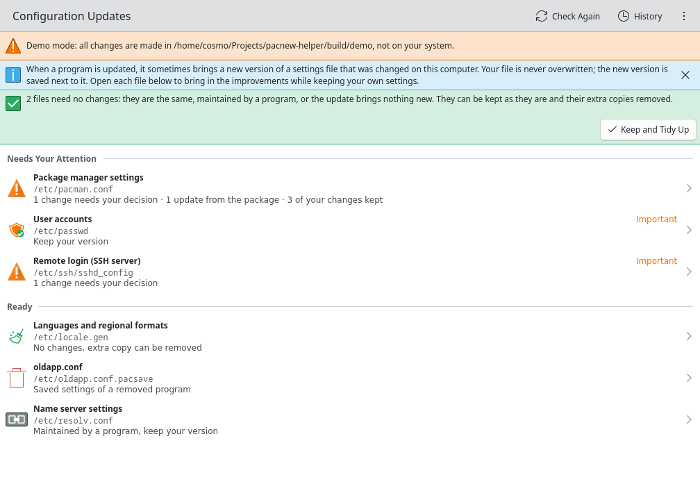
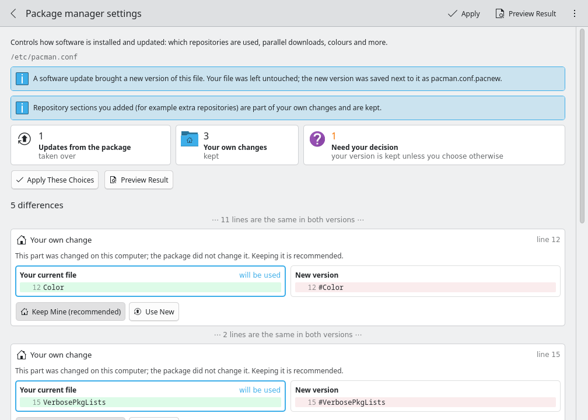
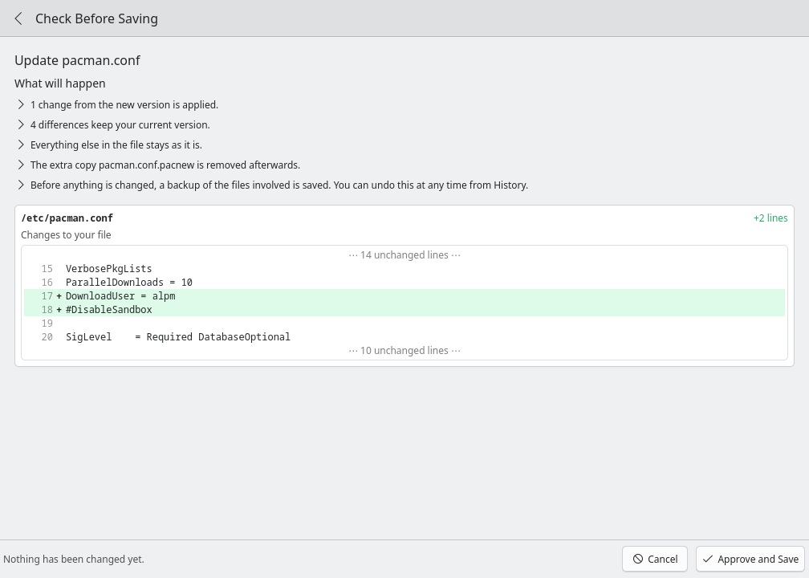
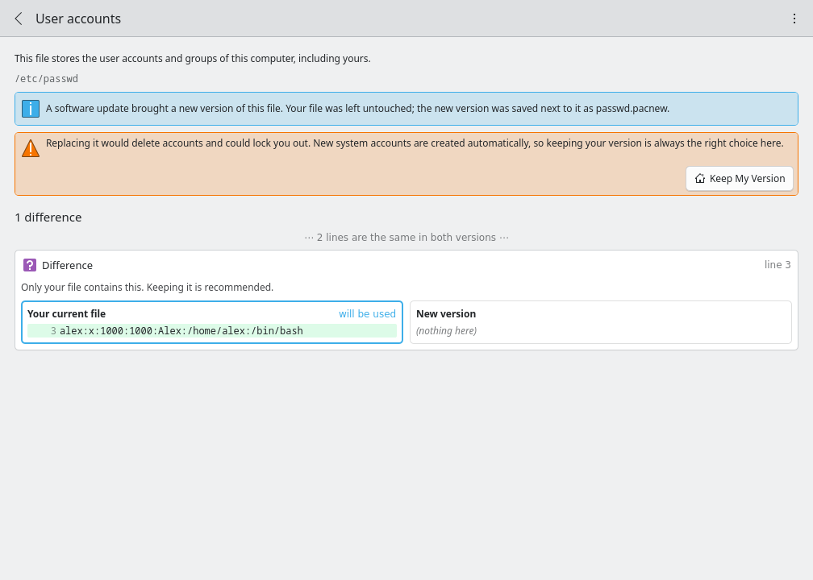

# Pacnew Helper

A KDE app that helps you deal with `.pacnew` and `.pacsave` files on Arch Linux and derivatives (CachyOS, EndeavourOS, …), explained in plain language and without needing to understand diffs.



## What problem does it solve?

When a package update brings a new version of a configuration file that was changed on your computer, pacman never overwrites your file. It saves the new version next to it as `file.pacnew`. Over time these pile up, and with them the improvements and fixes they contain. Merging them by hand (`pacdiff`, `vimdiff`) is error-prone and hard for anyone who isn't comfortable editing system files.

Pacnew Helper lists every such file, works out for each difference **who changed it**, and offers a safe recommendation:

| Difference | Meaning | Default |
|---|---|---|
| **Update from the package** | Only the new version changed this part; you never touched it | take the new version |
| **Your own change** | You (or a tool) changed this part; the package didn't | keep yours |
| **Changed on both sides** | Both changed the same setting | keep yours, you can choose |
| **Difference** (no history available) | Can't tell who changed it | take pure additions, keep the rest |

Most files can be updated with a single click. Only real conflicts need a decision.



## How it decides: three-way merge

A plain diff only shows *that* two files differ. To know *who* changed a line, you also need the file your version was originally created from. Pacnew Helper takes that from the **previous package version in the pacman cache** (`/var/cache/pacman/pkg`). It extracts the file with `bsdtar` and picks the cached version closest to your file. With these three versions (previous default, yours, new default) it runs a classic three-way merge (the merge3 algorithm).

It then refines that merge. A standard three-way merge treats edits on neighbouring lines as one conflict, so a new option the package adds right below a setting you changed would be lost with "keep mine". Pacnew Helper aligns conflicting lines by the setting they configure (`ParallelDownloads = 10` ↔ `ParallelDownloads = 5`) and pulls independent additions out as separate updates.

If the previous version is no longer cached (e.g. after `paccache -r`), it falls back to a two-way comparison with cautious defaults and says so.

## Safety

- **Nothing is written without your approval.** Every action (updating a file, keeping your version, tidying up several files at once, removing saved settings, undo) first opens a **Check Before Saving** page. It lists in plain sentences what will happen and shows exactly how each file on disk changes: removed and added lines with line numbers and a little context. Only **Approve and Save** sends the change to the privileged helper, and it writes exactly what the page showed.
- **Backups and undo:** before every change, the affected files are copied to `/var/lib/pacnew-helper/backups/`. The History page undoes any change with one click, and an undo can itself be undone.
- **Files maintained by programs** (symlinks like a systemd-resolved `resolv.conf`, or files whose header says "Generated by NetworkManager", `rate-mirrors`, `reflector`, …) are recognised. The recommendation is to keep them; one click removes the extra copy.
- **User accounts** (`passwd`, `shadow`, `group`, `gshadow`) can only be kept, never replaced. This is enforced in the privileged helper, not just hidden in the UI.
- **sudoers** files are validated with `visudo -c` before they are installed. An invalid result is refused and nothing changes.
- **Important files** (`fstab`, `crypttab`, `mkinitcpio.conf`, PAM, SSH server, boot settings) are marked and come with a plain-language warning, plus a follow-up hint where needed (e.g. "run `mkinitcpio -P`").





### Privileges

The app runs as your user. Only the actual changes go through a small **KAuth helper** that runs as root after a polkit password prompt (`auth_admin_keep`, so you're asked at most once per session). The helper treats every request as untrusted:

- Paths must be absolute, below `/etc`, free of `.`/`..`, and must not leave `/etc` through symlinked directories.
- A matching `.pacnew`/`.pacsave` must exist next to the file.
- Symlinked files are never written.
- Files are written atomically (temporary file, `fsync`, `rename`), keeping the original owner and permissions.

## Install

### Arch / CachyOS package

From the `[geeks.gay]` repository (`repo.geeks.gay`):

```sh
sudo pacman -S pacnew-helper
```

Or build the latest release yourself with the PKGBUILD in `packaging/arch/`:

```sh
cd packaging/arch
makepkg -si
```

### Build from source

```sh
cmake -B build -G Ninja -DCMAKE_BUILD_TYPE=RelWithDebInfo
cmake --build build
ctest --test-dir build          # unit, end-to-end and controller tests
```

Changing files needs the KAuth helper and its polkit policy installed system-wide (`sudo cmake --install build`, or the package). Without them, the app can still scan and review, and it tells you how to install it when you try to apply.

### Try it without touching your system

`--root` points the app at a copy of a system instead of `/`. Everything works, including applying, backups and undo, but only inside that folder and without administrator rights:

```sh
cp -r autotests/demo-root /tmp/pacnew-demo
./build/bin/pacnew-helper --root /tmp/pacnew-demo
```

The demo contains one example of each case: a `pacman.conf` with your own changes, a package update and a conflict, an identical file, `passwd`, a NetworkManager-generated `resolv.conf`, an `sshd_config` without cached history, and a `.pacsave`.

## Project layout

| Path | |
|---|---|
| `src/core/merge.*` | Line diff (LCS), three-way merge, key-based conflict splitting |
| `src/core/fileinfo.*` | Plain-language descriptions, risk levels and policies for known files |
| `src/core/operations.*` | The privileged operations: validation, atomic writes, backups, undo |
| `src/helper/` | KAuth helper (thin wrapper around `operations`) and polkit actions |
| `src/app/` | Scanner (finding files, owners, cached base), models, controller |
| `src/qml/` | Kirigami UI |
| `autotests/` | Merge, operations, end-to-end pipeline and controller tests; `demo-root/` |
| `packaging/arch/PKGBUILD` | Arch package |

## License

GPL-3.0-or-later
